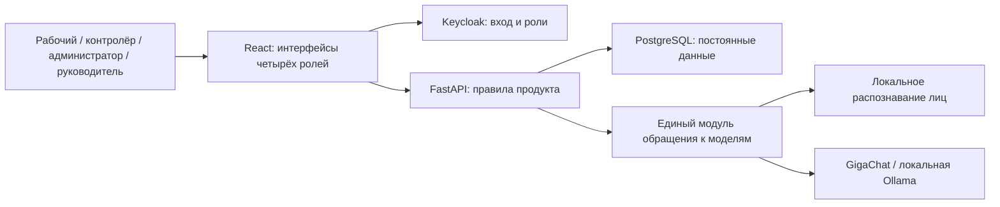

# План «Проходной»: 4 человека, 4 часа

## 1. Цель и архитектура

Собрать работающий стенд с полным обязательным объёмом кейса. **Готовность к защите определяется проверками Д1–Д11 из пункта 7.1 и отсутствием оснований для снятия из пункта 7.4.**

Backend делим на модули: персонал, проходы, смены, перемещения, аналитика и помощник. Запуск — на этом Mac через Docker Compose; Ollama работает непосредственно в macOS. Такая структура позволяет отдельно развивать функции и переносить обработку моделей на другой сервер.

## 2. Поведение продукта и интерфейсы

**Регистрация и вход.** Собственный интерфейс администратора создаёт рабочего, связывает его с учётной записью Keycloak и принимает эталон лица. Сервер отклоняет фото без лица, с несколькими лицами или непригодным изображением. Рабочий входит через SSO и один раз регистрирует passkey на Android. Backend проверяет токены и права; личность рабочего определяется по учётной записи, а не по переданному клиентом идентификатору.

**QR и проход.** Контролёр выбирает вход или выход и открывает QR. Каждое открытие создаёт новую серверную попытку и новый код. Закрытие отменяет код; повторное открытие заменяет даже неиспользованный код. Автообновления по времени нет. :codex-annotation{index="1"}

Рабочий сканирует QR своим телефоном и подтверждает конкретную попытку через passkey. Камера проходной получает лицо. Сервер проверяет оба подтверждения и однократно принимает решение. Старый QR, старое подтверждение и повторная отправка не создают проход. Состояние открытого экрана передаём через WebSocket; при обнаружении разрыва соединения сервер отменяет незавершённую попытку.

**Лица.** Используем YOLOv8 с весами для лиц и InsightFace `buffalo_l` для сравнения личности. При проходе включаем проверку живого лица из InsightFace; при регистрации фотографии она не применяется. Порог сравнения проверяем на предоставленных фотографиях и живых участниках. Новый человек добавляется без обучения модели. [YOLOv8 Face](https://github.com/akanametov/yolo-face), [InsightFace и проверка живого лица](https://github.com/deepinsight/insightface/blob/master/python-package/docs/liveness.md).

**Смены и хранение.** Успешный вход открывает смену, выход закрывает её. Повторные и одновременные запросы не создают двойную смену. Персонал, эталоны, ключи подтверждения, попытки, отказы, смены, координаты и настройки плана хранятся в PostgreSQL. Все отказы имеют понятную причину и запись в журнале.

**Перемещения.** Телефон отправляет геолокацию каждые 30 секунд только при открытой смене. Для демонстрации предусмотрен явно обозначенный режим симуляции с интервалом 10 секунд: точки проходят через тот же backend и сохраняются в смену. После закрытия сервер перестаёт принимать координаты. Интерфейс показывает ошибки разрешений, точность и отсутствие свежих данных.

**План и аналитика.** Один объект, три зоны из пакета: котлован, бетономешалка, место для курения. Создаём схематический план; фотографии используем как материалы зон. Геопривязка по трём контрольным точкам и границы зон редактируются через интерфейс.

Интенсивность измеряем количеством наблюдаемых посещений зоны: последовательные точки внутри одной зоны считаются одним посещением. Правило едино для карты, отчётов и помощника. Карта различает отсутствие посещений и низкую активность; маршруты имеют легенду по людям. Общие фильтры: день, диапазон дней, часы, один/несколько/все работники. Отдельно показываем находящихся внутри и время входа.

**Помощник.** Два работающих провайдера: GigaChat и Ollama с `qwen3:4b`; провайдер, модель и адрес задаются конфигурацией. Все обращения к моделям изолированы в одном модуле. Числа вычисляет backend, модель формулирует ответ с проверяемыми ссылками на эти факты; неподтверждённые значения не выводятся. Предусматриваем отсутствие данных, тайм-аут и некорректный ответ. [Локальная модель](https://ollama.com/library/qwen3:4b).

REST API покрывает персонал, регистрацию телефона, подтверждение прохода, координаты, отчёты, план и помощника. Клиент передаёт доказательства и команды; решение о проходе принадлежит серверу.

## 3. Распределение четырёх часов

| Участник | Ответственность |
|---|---|
| 1 | Backend: SSO, passkey, проходы, смены, журнал |
| 2 | React: телефон, проходная, администратор, интерфейс руководителя |
| 3 | Распознавание лиц, GigaChat, Ollama, общий модуль моделей |
| 4 | Запуск стенда, PostgreSQL, план, аналитика, сбор документации |

- **0:00–0:20:** доступный репозиторий, контракты интерфейсов, запуск сервисов; сразу начинаем загрузку моделей и проверяем доступ к GigaChat.
- **0:20–1:15:** регистрация нового человека → телефон → камера → вход → смена. Рано проверяем чужое лицо и повтор подтверждения.
- **1:15–2:30:** перемещения, план, отчёты, помощник; объединяем все интерфейсы с реальными данными.
- **2:30–3:15:** отрицательные проверки, переключение провайдеров, перезапуск и исправления.
- **3:15–4:00:** полный живой прогон, проверка документации и репетиция небольшой правки за 15 минут.

Каждый участник делает собственные содержательные коммиты. Ориентир — минимум 15 по команде; документацию ведём по ходу работы.

## 4. Проверки допуска

| Критерий | Проверка перед защитой |
|---|---|
| Д1 | Другой участник поднимает стенд по инструкции |
| Д2 | Подмена клиентского результата не разрешает проход |
| Д3 | Обязательные действия доступны через собственные интерфейсы |
| Д4 | Перезапуск сохраняет персонал, смены, координаты и журнал |
| Д5 | Реальный результат модели используется при проходе и в помощнике |
| Д6 | Один запрос выполняется через внешний и локальный провайдер |
| Д7 | Судьи имеют доступ к репозиторию; история и авторство видны; секретов нет |
| Д8 | Есть все шесть документов из раздела 5.5 |
| Д9 | Заведённый на защите новый человек проходит без обучения модели |
| Д10 | Чужое лицо, чужое подтверждение, фотография и повтор запроса не дают проход |
| Д11 | Все четверо объясняют свою часть и выполняют небольшое изменение |

Дополнительно проверяем закрытие и повторное открытие QR, одновременные проходы, координаты после закрытия смены, одинаковые фильтры аналитики и ошибки моделей.

Помощник должен отвечать на все четыре примера из кейса: кто внутри; кто вчера работал менее четырёх часов; какая зона вчера была самой людной по выбранной метрике; какие отказы были за неделю и почему. Также проверяем сводку периода и ответ при отсутствии данных.

Шесть документов: запуск; архитектура со схемой; журнал 3–6 решений; локальная модель и переключение; ограничения и следующие 10 часов; отчёт об использовании AI.

## 5. Зафиксированные условия и ограничения

Проверяем Android, один объект и один стенд. Используем HTTPS-туннель с постоянным адресом ngrok, чтобы сохранялась привязка passkey; учётная запись туннеля и доступ к GigaChat — предпосылки запуска. [Документация ngrok](https://ngrok.com/docs/pricing-limits/free-plan-limits).

Браузерную геолокацию проверяем при открытой странице. Симуляция обозначена явно; исторические демонстрационные события сохраняются в БД, отчёты вычисляются из них. Полных описаний С1–С22 в предоставленном кейсе нет — проверки выше выведены из явных требований.

Дополнительные функции, BLE и нативное приложение откладываем. Реальную точность моделей, работу камеры и туннеля ещё не проверяли; четыре часа — жёсткий срок, прохождение допуска подтверждает только живой прогон.
