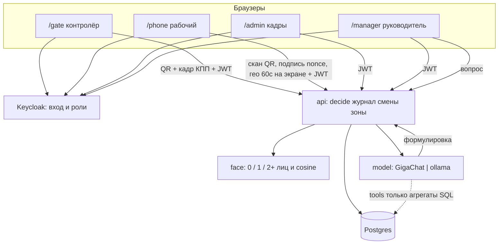

# Схема решения: «Проходная»

Рабочая архитектура, чтобы начинать. Собрана из кейса и решений команды 10.10. Бонусы §7.2 не входят.

Стек (фиксируем, чтобы писать код; кейс оставил выбор нам):

- `web` — Next.js, четыре маршрута (три роли Д3 + руководитель отдельно, как решили)
- `api` — отдельный процесс, Hono/Node, только он вызывает `decide()`
- `keycloak` — вход и роли (организаторы сказали: его используют). В compose.
- `face` — Python, эталон и кадр, 1:1, не «есть лицо»
- `postgres` — постоянное хранилище
- `model` — один слой: GigaChat + Ollama, адрес из `.env`

Поднять: `docker compose up`. Секреты только в `.env`, в репо — `.env.example`. Passkey не делаем: подтверждение — одноразовый QR.

Доки сдачи: [запуск](run.md), [локальная модель](local-model.md), [ограничения](limits.md), [отчёт об ИИ](ai-usage.md).

## Карта системы



Клиент не решает «пропустить». Подмена ответа в DevTools не должна открыть смену: `decide()` на сервере, журнал в той же транзакции.

Модуль `apps/api/src/modules/outbound.ts` — единственный в API, кто вызывает сервис лиц и текстовую модель. `MODEL_PROVIDER` переключает только текст и не подменяет YOLO и InsightFace.

## Экраны (свои, не swagger)

| Маршрут | Роль | Устройство | Обязательный сценарий |
| --- | --- | --- | --- |
| `/gate` | контролёр | планшет | вход/выход, открыть одноразовый QR, снять лицо, показать пропуск или причину отказа |
| `/phone` | рабочий | телефон | один раз зарегистрировать открытый ключ; сканировать QR с планшета и подписать nonce; слать гео раз в минуту, только пока `/phone` на экране и телефон разблокирован; кнопки Бетон / Котлован / Курилка |
| `/admin` | администратор | ПК | завести/править человека, эталон с отбраковкой 0/2+ лиц, список и статус, журнал всех попыток |
| `/manager` | руководитель | ПК | кто внутри и с какого времени; схема с нарисованными зонами; тепло посещений; пусто ≠ мало; маршруты с подписями; фильтры день/диапазон/часы/люди; отчёт по смене и по человеку; помощник |

Русские статусы и ошибки. Живые данные API. Нарисованные цифры — снятие блока.

## Проход

Контролёр **начинает** проход (§3.2): выбирает вход или выход и открывает QR. Каждое открытие = новая попытка и новый код на сервере. Закрыл экран и API ещё доступен — `POST /cancel`, код отменён. Открыл снова — даже неиспользованный код заменён. Автообновления по таймеру нет. Обрыв wifi или websocket попытку не отменяет: клиент уже не вызовет `/cancel`. `decide()` в той же транзакции перечитывает строку: не отменена, не использована, `ttl` жив. Молчащий клиент гасит только `ttl`.

1. Админ заводит человека (поля пропуска пакета) + `_фото` как эталон. `face`: 0 / 1 / 2+ лиц. Сохранить только «1». Embedding в БД. Детект — готовый YOLO-face, сравнение 1:1 — InsightFace `buffalo_l` (не учим свою модель). На проходе — ещё проверка «живое лицо»; на регистрации фото — нет.
2. Рабочий входит в Keycloak (роль `worker`). Админ при заведении **связывает** человека с этой учёткой. API смотрит `sub` из JWT, не id из тела запроса. Учётки: `worker` / `gate` / `admin` / `manager`. Для прохода обязательна строка `devices`: телефон при привязке регистрирует открытый ключ (ECDSA P-256).
3. Контролёр открыл QR → `POST /attempts`. Телефон **сканирует** этот QR и шлёт подпись nonce попытки. Планшет шлёт кадр КПП.
4. API один раз: QR этой попытки, не использован, не отменён, `ttl` жив → подпись сходится с ключом человека из JWT `sub` → кадр 1:1 с эталоном. Старый QR, фото QR, повтор, чужое лицо, чужое устройство — отказ, фраза в журнал. Скопированный bearer без ключа — «чужое устройство».
5. Вход: одна открытая смена, повторный запрос вторую не создаёт. Выход: закрыть, посчитать время, гео в эту смену больше не принимать.

Демо пакета: `_фото` = эталон, `_проходная_*` = кадр КПП. Д9: судья заводит своего.

## Смены, гео, зоны

- На объекте = есть смена с пустым `ended_at`.
- Гео: раз в **60 с** (ваше решение), только открытая смена и только пока `/phone` на экране, а телефон разблокирован. Скрытая вкладка и блокировка экрана точки не отдают. В фоне не обещаем. После выхода сервер координаты этой смены отвергает. Камера и геолокация требуют HTTPS даже в локальной сети.
- Имитация: три кнопки Бетон / Котлован / Курилка, **явно подписаны как симуляция**, тот же `POST /locations`, `source=button`. Судьям показать этот экран.
- Три зоны из пакета. Схема — чертёж объекта; три фото — материалы зон. Админ в UI рисует границы зон и три точки привязки плана (пиксель x/y и lat/lon). В пакете GPS нет. Полигоны не зашиты в код. Сервер по трём точкам кладёт GPS на чертёж и только потом проверяет точку в полигоне.
- Метрика теплокарты, маршрутов и отчётов: **посещения**. Подряд идущие точки в одной зоне = одно посещение. Смена зоны = новое. Пусто = 0 посещений; мало ≠ пусто.
- Вопрос помощника «в какой зоне больше всего людей» считает разных людей и в ответе говорит «человек», не «посещение».
- Маршрут: последовательность зон по времени, разные люди разным цветом, подпись ФИО.
- Фильтры на тепло и на маршруты: день, диапазон дней, часы внутри дня, люди (один / несколько / все).
- Отчёт по смене и по человеку за период — те же посещения.

## Помощник

Цифры только из SQL. Модель формулирует и не пишет цифры сама: в тексте только `{имя_поля}`, значение подставляет сервер. Промпты в `prompts/`. Нет строк → «данных нет». Таймаут GigaChat — статус и повтор, не выдуманные числа.

`MODEL_PROVIDER=gigachat|ollama`, локально `qwen3:4b` (рабочая, не заглушка). Переключатель только у текста. На защите меняют env. Инструкция: [local-model.md](local-model.md).

Помощник обязан закрыть примеры кейса: кто внутри; кто вчера < 4 часов; в какой зоне больше всего людей (разные люди, слово «человек»); отказы за неделю и почему; плюс сводка периода и «данных нет».

Сводка за период. Имена полей фиксированы, модель их не выбирает:

- `people` — разные люди, у которых смена началась в периоде;
- `shifts` — число таких смен;
- `deviations` — смены, начатые в периоде, длительность больше 0 и меньше 4 часов (14400 секунд). Порог тот же, что у вопроса «кто меньше 4 часов». Длительность: `COALESCE(ended_at, now()) - started_at`;
- `refusals` — строки журнала с `decision = 'deny'` за период;
- `shifts_without_points` — открытые смены (`ended_at` пустой) без единой строки в `locations`, уже начатые к концу периода;
- `anomalies` — `refusals + shifts_without_points`.

## Данные (Postgres)

`people` — человек, эталон embedding, поля пропуска, текущий статус  
`people.keycloak_sub` — связь с учёткой Keycloak  
`devices` — обязательна для прохода; телефон при привязке пишет открытый ключ. Личность = JWT `sub`, не поле тела  
`attempts` — попытка, nonce, ttl, used, направление, итог, причина  
`shifts` — начало, конец, длительность  
`locations` — `shift_id`, время, зона или координаты, `gps|button`  
`plans` — чертёж объекта  
`plan_calibration_points` — три точки плана: `pixel_x`, `pixel_y`, `lat`, `lon`  
`zones` — имя, id фото, `plan_id`, полигон в пикселях этого плана  
`journal` — кто, когда, что, причина  
`visits` — заход в зону (метрика), `shift_id`, `zone_id`, время  

Перезапуск API не теряет строки.

## API (черновик контракта)

Все ответы об отказе — русский текст, не код.

- `POST /people` `PATCH /people/:id` — заведение, эталон; отказ если 0 или 2+ лиц  
- `GET /people` — список и статус  
- `POST /devices` — телефон регистрирует открытый ключ  
- `GET /me` — worker читает своего человека и открытую смену по JWT sub; закрытая смена — null
- `GET /attempts/:id` — статус и результат без nonce: только gate-владелец или подтвердивший worker
- `POST /attempts` — контролёр открыл QR (вход/выход)  
- `POST /attempts/:id/cancel` — закрыл экран, пока клиент ещё достучался до API. Обрыв связи сюда не приводит  
- `POST /attempts/:id/scan` — телефон отсканировал QR и прислал подпись nonce. Нет ключа — «чужое устройство»  
- `POST /attempts/:id/decide` — кадр КПП + уже подтверждённый QR; только сервер, в той же транзакции перечитывает попытку  
- `POST /locations` — гео 60 с или кнопка зоны; отказ если смена закрыта. GPS на план кладётся по трём точкам привязки  
- `GET /site/now` — кто внутри и с какого времени  
- `GET /analytics/heat` `GET /analytics/routes` `GET /analytics/reports` — фильтры как в §4.1, метрика посещения  
- `PUT /zones/:id/polygon` — полигон зоны в пикселях плана  
- `GET /plans` `GET /plans/:id/calibration` `PUT /plans/:id/calibration` — три точки плана  
- `POST /assistant/ask` `POST /assistant/summary` — через model-слой, числа подставляет сервер  
- `GET /journal`

Минимальные GET-методы реализованы 10.10.2026 по явному разрешению пользователя для интеграции `/gate` и `/phone`. DTO и права — [demtory-api-needs.md](demtory-api-needs.md). Телефон передаёт в `POST /locations` `shift_id`; API сверяет его с открытой сменой под блокировкой и отклоняет координаты старой смены. `cancel` и `decide` разрешены только gate-владельцу попытки.

## Каталоги в репо

```
apps/web          /gate /phone /admin /manager
apps/api          decide, journal, shifts, zones, assistant
services/face     count_faces, embed, compare
prompts/          шаблоны GigaChat / разбор ответа
docs/run.md       запуск с нуля и кто какими учётками
docs/architecture.md  этот файл
docs/decisions.md
docs/local-model.md
docs/limits.md
docs/ai-usage.md
.env.example
docker-compose.yml   web, api, postgres, keycloak, face
Первый пакет/     как есть, не в код зашивать как единственных людей
```

## Порядок, чтобы рано сломать проход

1. compose + контракты + `.env.example`; сразу качаем веса face и проверяем ключ GigaChat.
2. Заведение → телефон привязан → камера → вход → смена. В этот же час: чужое лицо, старый QR, повтор decide.
3. Гео 60 с, кнопки симуляции, план с рисунком зон, отчёты, помощник на живых данных.
4. Перезапуск (Д4), смена провайдера модели (Д6), чужой человек судей (Д9/Д10).
5. Доки 5.5, 15 коммитов от всех, репетиция правки 10–15 мин.

Модули API: персонал, проходы, смены, перемещения, аналитика, помощник — отдельно, чтобы не писать в один файл вдвоём.

Кто за что: [roles.md](roles.md).

Keycloak — в стенде: организаторы сказали, его используют. Passkey не делаем (ваш QR). HTTPS обязателен всегда: камера и геолокация браузера требуют защищённый контекст даже в локальной сети. Как поднять стенд — [run.md](run.md), чего не обещаем — [limits.md](limits.md).
