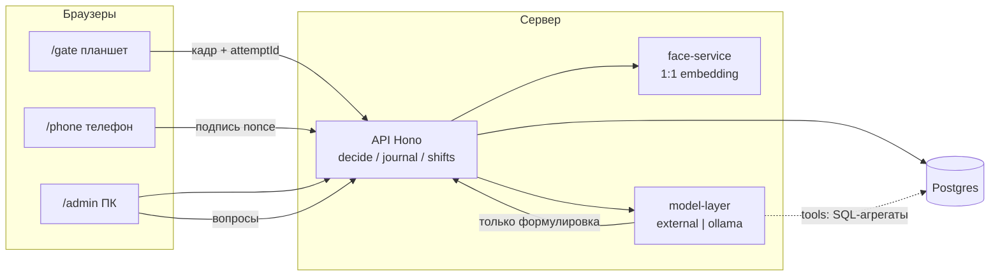

# Схема решения: «Проходная»

Цель на 7–10 часов: закрыть допуск Д1–Д11 и 28 баллов за непробиваемый проход. Красота и натив не оцениваются.

## Как устроено

Клиенты **не решают**, пускать или нет. Они шлют кадр и подпись. `decide()` живёт только в API, в одной транзакции с журналом.

## Процессы (docker compose)

| Сервис | Зачем |
| --- | --- |
| `web` | Next.js: `/gate`, `/phone`, `/admin` (+ руководитель на тех же экранах) |
| `api` | Hono/Node: проход, смены, гео, зоны, журнал |
| `face` | Python: «ровно одно лицо?» + embedding + cosine 1:1 |
| `postgres` | Люди, эталоны, ключи устройств, attempts, shifts, locations, zones |
| `ollama` | Локальный провайдер модели (профиль `local`) |

`.env` задаёт `MODEL_PROVIDER=openai|gigachat|ollama` и адреса. Смена провайдера на защите — правка env, без кода.

## Проход (то, что будут ломать)

1. Админ заводит человека: фото → `face` отвечает «0 / 1 / 2+ лиц». Сохранить можно только «1». В БД — embedding, не «на фото есть лицо».
2. Рабочий один раз на `/phone` создаёт ключ устройства (WebCrypto, private key не уходит с телефона). На сервер — только public key. Это нельзя переслать скрином: без ключа подпись не собрать.
3. Контролёр жмёт «вход» → API создаёт `attempt` + одноразовый `nonce` с TTL ~30 с.
4. Телефон подписывает `attemptId + nonce + personId`. Подпись и nonce повторно не принимаются.
5. Планшет шлёт кадр с камеры.
6. API: nonce свежий → подпись этого человека → embedding кадра 1:1 с эталоном. Оба условия обязательны. Успех: открыть/закрыть смену. Отказ: человеческая причина в журнале.

Статичный QR, «просто есть лицо», решение на клиенте — дисквал. Не делаем.

## Смены, гео, зоны

- Открытая смена = человек на объекте. Кто внутри = `shifts WHERE ended_at IS NULL`.
- Пока смена открыта, телефон шлёт точки. После выхода точки в эту смену не пишутся.
- План площадки — картинка из пакета кейса (ещё не в репо). Зоны — полигоны в БД, рисуются в `/admin`, не в коде. Точка → зона = point-in-polygon.
- **Одна метрика:** время пребывания в зоне (секунды). «Пусто» = 0 секунд, «мало» = ниже порога, но не ноль. Маршрут = последовательность зон по времени.

Имитация гео на защите: на `/phone` кнопка «демо-маршрут» + ручные координаты. Судьям показать.

## Помощник

Цифры считает API (SQL). Модель только формулирует. Tools: `who_inside`, `denials`, `hours_worked`, `zone_heat`, `summary`. Нет строк в БД → «данных нет», не выдумка. Промпты лежат в `prompts/`, не в чате.

## Что не строим

Натив, свой train лица, 1С, микросервисы сверх таблицы выше, второй фронтенд-фреймворк, статичный QR «для простоты».

## Кто за что на хакатоне

Параллель с первого часа: API+decide ∥ gate ∥ phone ∥ admin. Аналитика и помощник — когда в БД уже есть attempts и точки.

| Кусок | Агент в Cursor | Первый коммит |
| --- | --- | --- |
| decide, журнал, Postgres | `/backend-pass` | таблицы + `decide()` |
| планшет | `/gate` | камера, статус с API |
| телефон | `/worker-phone` | ключ + подпись nonce |
| эталон, список, журнал UI | `/enroll-admin` | отказ 0 / 2 лица |
| зоны, кто внутри | `/analytics` | полигон + список смен |
| модель, 2 провайдера | `/assistant` | `getModel()` + tool `who_inside` |
| доки 5.5 | `/docs-defense` | этот файл + `docs/decisions.md` |
