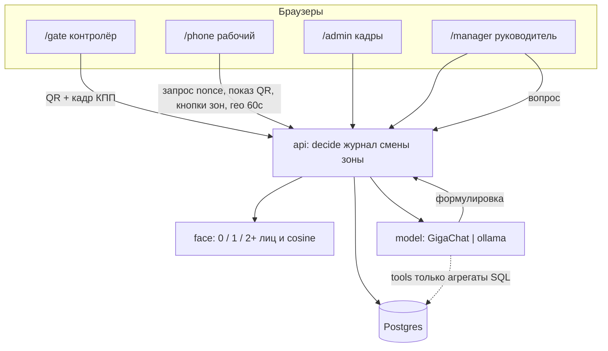

# Схема решения: «Проходная»

Рабочая архитектура, чтобы начинать. Собрана из кейса и решений команды 10.10. Бонусы §7.2 не входят.

Стек (фиксируем, чтобы писать код; кейс оставил выбор нам):

- `web` — Next.js, четыре маршрута (три роли Д3 + руководитель отдельно, как решили)
- `api` — отдельный процесс, Hono/Node, только он вызывает `decide()`
- `face` — Python, эталон и кадр, 1:1, не «есть лицо»
- `postgres` — постоянное хранилище
- `model` — один слой: GigaChat + Ollama, адрес из `.env`

Поднять: `docker compose up`. Секреты только в `.env`, в репо — `.env.example`.

## Карта системы



Клиент не решает «пропустить». Подмена ответа в DevTools не должна открыть смену: `decide()` на сервере, журнал в той же транзакции.

## Экраны (свои, не swagger)

| Маршрут | Роль | Устройство | Обязательный сценарий |
| --- | --- | --- | --- |
| `/gate` | контролёр | планшет | вход/выход, снять лицо, считать QR с телефона, показать пропуск или причину отказа |
| `/phone` | рабочий | телефон | один раз получить право на QR; показать одноразовый QR; слать гео раз в минуту в открытой смене; кнопки Бетон / Котлован / Курилка |
| `/admin` | администратор | ПК | завести/править человека, эталон с отбраковкой 0/2+ лиц, список и статус, журнал всех попыток |
| `/manager` | руководитель | ПК | кто внутри и с какого времени; схема с нарисованными зонами; тепло посещений; пусто ≠ мало; маршруты с подписями; фильтры день/диапазон/часы/люди; отчёт по смене и по человеку; помощник |

Русские статусы и ошибки. Живые данные API. Нарисованные цифры — снятие блока.

## Проход

1. Админ заводит человека (поля с пропуска пакета: ФИО, № пропуска, должность, организация, объект, срок) + `_фото` как эталон. `face` отвечает 0 / 1 / 2+ лиц. Сохранить только «1». В БД — embedding.
2. Рабочий на `/phone` один раз привязывает устройство к себе (номер пропуска). Без этой привязки nonce не выдаётся.
3. Контролёр жмёт вход или выход → API создаёт `attempt` (направление, `nonce`, TTL, не использован).
4. Телефон, будучи тем человеком, запрашивает актуальный `attempt`. API отдаёт полезную нагрузку QR. Телефон **только рисует** то, что прислал сервер. Клиент QR не подписывает и не выдумывает.
5. QR одноразовый: тот же nonce повторно и после TTL — отказ. Сфоткал и принёс позже — отказ.
6. Планшет читает QR и шлёт кадр камеры + payload QR. API: nonce свежий → payload этого attempt и этого человека → `face` сравнивает кадр с эталоном 1:1. Оба условия сразу.
7. Успех вход: открыть смену, человек на объекте. Успех выход: закрыть смену, посчитать время, гео в эту смену больше не писать. Отказ: человеческая фраза в журнал.

Демо-материалы пакета: `_фото` = эталон, `_проходная_*` = кадр КПП. Д9: судья заводит своего человека своими фото.

## Смены, гео, зоны

- На объекте = есть смена с пустым `ended_at`.
- Гео: раз в 60 с, только пока смена открыта.
- Имитация (показать судьям): три кнопки на телефоне. Жест зоны пишет точку в текущую смену с `source=button` и именем зоны из пакета.
- Три зоны с именами пакета: Бетономешалка (CAM-02A), Котлован (CAM-05B), Место для курения (CAM-04A). Схема руководителя — эти три фото. Админ **рисует** полигон на фото. Не в коде.
- Метрика: **посещения**. Заход в зону = +1. Пусто = 0. Мало ≠ пусто (порог «мало/много» — число в конфиге, пока 3, меняется без правки логики).
- Маршрут: последовательность зон по времени, разные люди разным цветом, подпись ФИО.
- Фильтры на тепло и на маршруты: день, диапазон дней, часы внутри дня, люди (один / несколько / все).
- Отчёт по смене и по человеку за период — те же посещения.

## Помощник

Цифры только из SQL. Модель формулирует. Промпты в `prompts/`. Tools: кто внутри; отказы за период; кто меньше 4 часов за день; зона с максимумом посещений; сводка (люди, смены, отказы). Нет строк → «данных нет». Таймаут GigaChat — статус и повтор, не выдуманные числа.

`MODEL_PROVIDER=gigachat|ollama`. На защите меняют env и показывают второй. Локальный — рабочий Ollama, не пустая функция. Инструкция отдельным файлом (§5.5).

## Данные (Postgres)

`people` — человек, эталон embedding, поля пропуска, текущий статус  
`devices` — привязка телефона к человеку (один раз)  
`attempts` — попытка, nonce, ttl, used, направление, итог, причина  
`shifts` — начало, конец, длительность  
`locations` — `shift_id`, время, зона или координаты, `gps|button`  
`zones` — имя, id фото схемы, полигон, нарисован в UI  
`journal` — кто, когда, что, причина  
`visits` — заход в зону (метрика), `shift_id`, `zone_id`, время  

Перезапуск API не теряет строки.

## API (черновик контракта)

Все ответы об отказе — русский текст, не код.

- `POST /people` `PATCH /people/:id` — заведение, эталон; отказ если 0 или 2+ лиц  
- `GET /people` — список и статус  
- `POST /devices` — привязка телефона  
- `POST /attempts` — контролёр начал вход/выход  
- `GET /attempts/current` — телефон получает payload QR  
- `POST /attempts/:id/decide` — QR + кадр; только сервер  
- `POST /locations` — гео 60 с или кнопка зоны  
- `GET /site/now` — кто внутри и с какого времени  
- `GET /analytics/heat` `GET /analytics/routes` `GET /analytics/reports` — фильтры как в §4.1  
- `PUT /zones/:id/polygon` — рисунок админа  
- `POST /assistant/ask` `POST /assistant/summary` — через model-слой  
- `GET /journal`

## Каталоги в репо

```
apps/web          /gate /phone /admin /manager
apps/api          decide, journal, shifts, zones, assistant
services/face     count_faces, embed, compare
prompts/          шаблоны GigaChat / разбор ответа
docs/run.md       запуск с нуля и кто какими учётками
docs/architecture.md  этот файл
docs/decisions.md
docs/local-model.md
docs/limits.md
docs/ai-usage.md
.env.example
docker-compose.yml
Первый пакет/     как есть, не в код зашивать как единственных людей
```

## Порядок коммитов, чтобы начать сегодня

1. compose: postgres + пустой api + web с четырьмя пустыми маршрутами + `.env.example`
2. таблицы и журнал
3. admin: заведение + face 0/1/2+
4. phone: привязка устройства + одноразовый QR
5. gate: камера + сканер QR + вывод решения сервера
6. смены + гео 60 с + кнопки зон
7. manager: кто внутри; рисование зон; тепло посещений; маршруты; фильтры; отчёты
8. model-слой GigaChat + Ollama + промпты + сводка
9. доки 5.5 и 15 коммитов от всех

Пока роли не разделены: не пишите в одни файлы вдвоём. Слои `api` / `web/gate` / `web/phone` / `web/admin`+`manager` не пересекаются.
